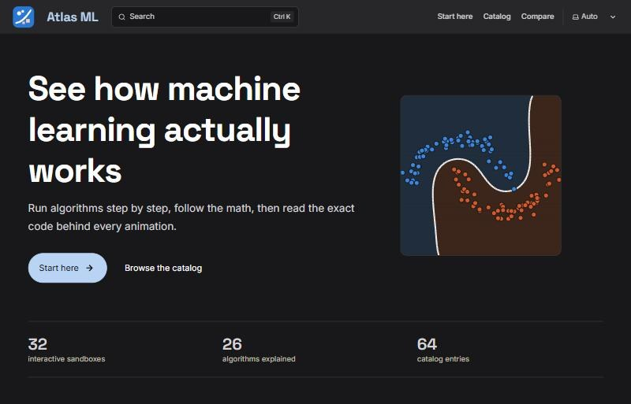
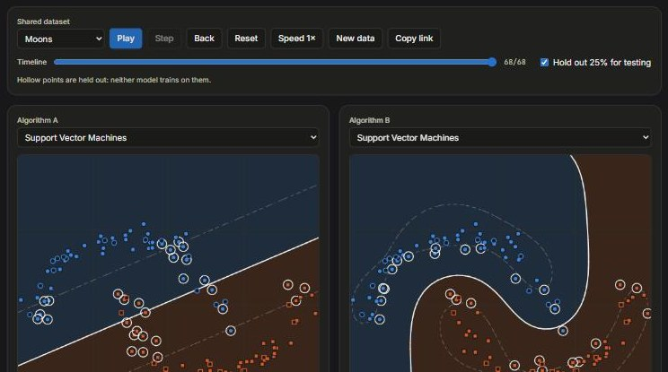
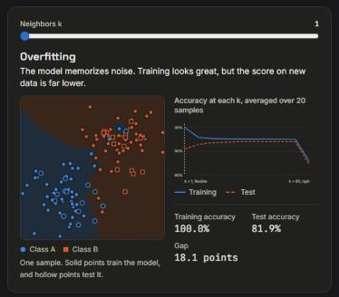

# Atlas ML

**Watch machine learning algorithms run, step by step, in your browser.**

[Try it live](https://pabl0aranda.github.io/Atlas-ML/) · [Start here](https://pabl0aranda.github.io/Atlas-ML/start-here/) · [Report a bug](https://github.com/Pabl0Aranda/Atlas-ML/issues/new/choose)

[](https://github.com/Pabl0Aranda/Atlas-ML/actions/workflows/ci.yml)
[](https://github.com/Pabl0Aranda/Atlas-ML/actions/workflows/deploy.yml)
[](https://github.com/Pabl0Aranda/Atlas-ML/releases/latest)
[](LICENSE)

<!-- To add the sandbox GIF, save it as docs/images/sandbox.gif and replace the image below with:

-->


Find an algorithm, watch it run, read the math, and inspect the exact code behind every animation. Everything runs in your browser, on the same TypeScript the pages display, so there's nothing to install and no account to create.

## Features

- **32 interactive sandboxes.** Play, step and rewind a run, change settings, add your own samples, and share the exact setup as a link.
- **26 algorithms explained,** across supervised, unsupervised, statistical, deep and reinforcement learning, in a catalog of 64 entries.
- **Compare mode.** Run two algorithms side by side on identical data.
- **Train and test view.** Hold out data on classifiers to see overfitting directly.
- **Guided presets.** One-click setups that make a single idea visible, with notes based on real runs.
- **The full workflow.** Guides to data preparation, validation and testing, including indicators and validation matrices.
- **Foundations.** Overfitting and underfitting, bias and variance, gradient descent, and a section on distance metrics.
- **Works for everyone.** Sandboxes support touch and keyboard, and plots back up color with shape.

## See it in action

| Compare two models on the same data | See overfitting as it happens |
| :---: | :---: |
|  |  |

## Run it locally

You need Node.js 22.23.4 or later.

```bash
npm install
npm run dev
```

The site then runs at `localhost:4321`.

| Command | Action |
| :------ | :----- |
| `npm run dev` | Start the dev server |
| `npm test` | Run the unit, sandbox contract and link tests |
| `npm run check` | Type-check the project |
| `npm run build` | Build the site and search index into `dist/` |
| `npm run preview` | Serve the build. Search only works after a build |

## Tech stack

| Area | Tools |
| :--- | :---- |
| Site | Astro, Starlight |
| Interactive parts | Preact islands, canvas and SVG |
| Styling | Tailwind CSS |
| Math | KaTeX |
| Search | Pagefind |
| Tests | Vitest, `astro check` |

## Deployment

Every push to `main` runs the tests, builds the site and publishes it to [GitHub Pages](https://pabl0aranda.github.io/Atlas-ML/), using `.github/workflows/deploy.yml`.

The build is static, so any static host works. Two variables control it:

| Variable | Purpose | Example |
| :------- | :------ | :------ |
| `SITE_URL` | Public origin. Turns on the sitemap, canonical URLs and social image tags | `https://pabl0aranda.github.io` |
| `BASE_PATH` | Subfolder the site is served from. Leave it out at the root of a domain | `/Atlas-ML` |

```bash
SITE_URL=https://pabl0aranda.github.io BASE_PATH=/Atlas-ML npm run build
```

## Contributing

Ideas and fixes are welcome. [Open an issue](https://github.com/Pabl0Aranda/Atlas-ML/issues/new/choose) to report a bug, suggest a feature or propose an algorithm, and see [CONTRIBUTING.md](CONTRIBUTING.md) for how the project is organized.

## License

Released under the [MIT License](LICENSE).
